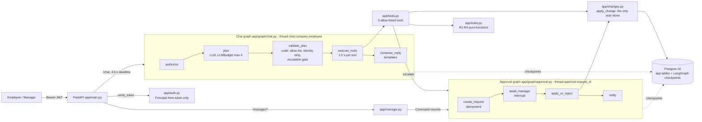

# ShiftDesk agent

A chat agent that lets employees of a multi-tenant commute platform change their pickup/drop
shift. It reads only the caller's own roster, enforces each company's cut-off and shift rules in
code, books a cab with a free seat (or lists the nearest ones), and escalates rule-blocked changes
to the company's transport manager. Approvals pause and survive restarts.

Stack: Python 3.12, FastAPI (sync endpoints), LangGraph 1.2 + PostgresSaver, Postgres 16,
psycopg 3, pydantic v2, PyJWT (HS256). Default `LLM_PROVIDER=fake`, so everything runs without
an API key. Source of truth for behaviour: [docs/SPEC.md](docs/SPEC.md).

## Quick start

```bash
docker compose up --build            # db + api; the api container applies schema.sql and seeds on start
# port 8000 busy? pick another host port:
API_PORT=8001 docker compose up --build
curl -s localhost:8000/healthz       # {"status":"ok"}
```

The clock is frozen at `APP_NOW=2026-11-20T18:45:00+05:30` (compose default) so the seed data
always produces the same rule outcomes. Copy `.env.example` to `.env` to override settings; `.env`
is never committed.

## Get a dev token and talk to it

`POST /dev/token` is the mock identity provider. It is only mounted when `ENABLE_DEV_ISSUER=true`
(compose default).

```bash
TOKEN=$(curl -s localhost:8000/dev/token -H 'content-type: application/json' \
  -d '{"company_id":"acme","employee_id":"E101","role":"employee"}' | python3 -c 'import sys,json;print(json.load(sys.stdin)["token"])')

curl -s localhost:8000/chat -H "authorization: Bearer $TOKEN" -H 'content-type: application/json' \
  -d '{"message":"can i change my drop time"}'
# -> cut-off explained with acme's numbers (120 min, cab at 20:30, 105 min away) + offer to send to manager
curl -s localhost:8000/chat -H "authorization: Bearer $TOKEN" -H 'content-type: application/json' \
  -d '{"message":"yes, send it to my manager"}'
# -> status "pending_approval": "Your request #... is waiting for Deepak Menon. Nothing has changed yet ..."

MGR=$(curl -s localhost:8000/dev/token -H 'content-type: application/json' \
  -d '{"company_id":"acme","employee_id":"MGR001","role":"manager"}' | python3 -c 'import sys,json;print(json.load(sys.stdin)["token"])')
curl -s "localhost:8000/manager/requests?status=pending" -H "authorization: Bearer $MGR"
curl -s localhost:8000/manager/requests/<request_id>/decision -H "authorization: Bearer $MGR" \
  -H 'content-type: application/json' -d '{"decision":"approve","note":"ok"}'
curl -s localhost:8000/requests/mine -H "authorization: Bearer $TOKEN"
```

With the fake LLM only the phrasings in `app/llm/fake.py` are understood (for example
"show my roster", "can i go a bit late", "make it 8 instead", "change my cab", "yes", "no").
Set `LLM_PROVIDER=groq|gemini` plus the key and model variables for free text.

Endpoints: `GET /healthz`, `POST /dev/token`, `GET /me`, `POST /chat`,
`GET /manager/requests?status=pending`, `POST /manager/requests/{id}/decision`, `GET /requests/mine`.

## Architecture



One Postgres holds both the business tables and the LangGraph checkpoints (no Redis). The app
uses two psycopg pools: a shared non-autocommit pool for tools/repo (`app/db.py`, max 10) and an
autocommit pool for `PostgresSaver` (`app/main.py` lifespan, max 5).

## Identity model

- JWT HS256 with claims `sub` (employee_id), `company_id`, `role` (`employee`|`manager`), `exp`, `iat`.
- Missing, forged, expired, unknown role, unknown company or unknown employee: `401` with
  "Your session is not valid. Please sign in again." (`app/auth.py`).
- `Principal(company_id, employee_id, role)` is built from the token only and passed to tools by
  code. Tools have no company/employee parameters; the plan schema rejects `company_id` /
  `employee_id` in tool args, and `validate_plan` strips them again.
- Manager endpoints: wrong role, other company or unknown id all return `404` (never `403`, so a
  manager cannot probe for other tenants' request ids). A decision on a request that is no longer
  pending returns `409` with a plain sentence.

## Budgets: 4 LLM calls, 4.5 s per message

- `LLMBudget(max=4)` is created per message in `node_plan`; every provider attempt is charged
  before it is made. Normal path = 1 planner call; a malformed plan gets one repair retry (2 calls).
  The optional reply-polish call from the spec is **not built**, so the worst case today is 2.
  When the budget or the provider fails, the reply degrades to a template; nothing calls again.
- `/chat` runs the graph in a worker thread with a hard 4.5 s deadline, then returns the plain
  fallback reply. Each tool has a 1.5 s timeout; Groq/Gemini HTTP calls have a 3 s timeout.
- Measured with `scripts/bench.py` (60 messages):

  | provider | p50 | p95 | max | LLM calls/message |
  |---|---|---|---|---|
  | real model | not measured | not measured | not measured | not measured |

## LLM vs plain code

| LLM (untrusted output) | Plain code |
|---|---|
| Turn the message + last 6 turns + a code-built `<roster>` block into a JSON plan: intent, direction, target time, ambiguity, allow-listed tool calls | Identity, tenant isolation, R1 cut-off, R2 max shift, R3 service window, R4 capacity, nearest slots, seat allocation, idempotency, escalation eligibility, approval state, audit log, every reply and error message |

The plan is validated by pydantic (allow-list, `HH:MM`, no identity args). Replies are templates
filled from structured tool results (`app/messages.py`), so rule explanations always carry the
company's real numbers and the model cannot promise something the code did not do.

**Escalation** (R1/R2 only, never R3 service window or R4 no seat): when a change is blocked by
the cut-off or the max-shift rule, the reply explains it and offers to send it to the transport
manager; the exact change is stored in chat state (`pending_slots.escalation`,
`awaiting="escalation_confirm"`). On the next message, `validate_plan` is the only place that can
set `escalate=True`, and only for that stored change. Any `escalate` the model sets on its own is
overwritten to `false`. The offer is consumed by the next message whatever it says.

## Restart survival

Chat context lives in the `chat:{company_id}:{employee_id}` checkpoint; each approval runs in its
own `approval:{request_id}` thread that pauses at `interrupt()` in `await_manager`. The decision
endpoint resumes it with `Command(resume=...)`. Code before `interrupt()` (`create_request`) re-runs
on resume, so it is an idempotent `INSERT ... ON CONFLICT DO NOTHING`. `tests/test_restart.py`
creates a pending request through `/chat` in one app instance, drops it (pools closed, singletons
cleared), reloads `app.main` into a brand-new app with a new lifespan and checkpointer, approves,
and checks the roster moved, the thread reached END and the chat history survived.

## Concurrency and idempotency

`app/changes.apply_change()` is the only code that moves a seat; direct bookings
(`submit_direct`) and approvals (`apply_approved`) both call it inside one transaction:

1. `idempotency_key = sha256(company|employee|entry|new_cab|new_time[|attempt])`
2. `INSERT ... ON CONFLICT (company_id, idempotency_key) DO NOTHING`; on conflict return the existing
   request's real status (`already_applied`, `pending_approval`, ...), never a made-up "applied"
3. `SELECT ... FROM cabs ... FOR UPDATE` serialises competing employees
4. count active bookings excluding the moving entry; full: roll back with `SEAT_TAKEN` (+ nearest slots)
5. move the roster entry and write `audit_log` (append-only, trigger blocks UPDATE/DELETE), commit

A rejected / expired / approved-not-applied / failed request can be raised again: the attempt
counter changes the key. No seat is held while a request waits for a manager; approval re-checks
capacity in the apply transaction and ends as `approved_not_applied` with a notification listing
the nearest options if the cab filled up. Pending requests older than `APPROVAL_TTL_HOURS` (app
clock, not DB `now()`) are marked `expired` when read.

Tests: 10 threads / 10 employees / 1 seat gives exactly 1 applied and 9 `SEAT_TAKEN`; the same
employee submitting 10x in parallel gives 1 request row and 1 seat (`tests/test_concurrency.py`).

## Tests, evals, bench

All Python runs inside the api image (host Python is not required):

```bash
API_PORT=8001 docker compose up -d --wait db
# tests (107 tests, fake LLM, real Postgres)
API_PORT=8001 docker compose run --rm --no-deps --entrypoint "" api pytest -q -rs
# evals: 45 cases, results written back into evals/eval_set.jsonl through the bind mount
API_PORT=8001 docker compose run --rm --no-deps --entrypoint "" --user "$(id -u):$(id -g)" \
  -v "$PWD/evals:/app/evals" api python -m evals.run
# live eval subset (real provider; quota/429/5xx are marked skipped) -> evals/live_results.jsonl
API_PORT=8001 docker compose run --rm --no-deps --entrypoint "" --user "$(id -u):$(id -g)" \
  -v "$PWD/evals:/app/evals" -e LLM_PROVIDER=groq -e GROQ_API_KEY=... -e GROQ_MODEL=... \
  api python -m evals.run --live
# latency / LLM-call bench (60 messages through /chat)
API_PORT=8001 docker compose run --rm --no-deps --entrypoint "" \
  -e LLM_PROVIDER=groq -e GROQ_API_KEY=... -e GROQ_MODEL=... api python scripts/bench.py
```

If the database volume is new, the schema and seed are applied by the api container on
`docker compose up`; for a db-only start run
`docker compose run --rm --no-deps --entrypoint "" api sh -c 'psql "$DATABASE_URL" -f db/schema.sql && python db/seed.py'`.
Results and methodology: [docs/EVAL_REPORT.md](docs/EVAL_REPORT.md).

## Repo layout

```
app/
  main.py          FastAPI app, lifespan (pools, checkpointer, graphs), /chat with 4.5 s deadline
  auth.py          JWT verification, Principal, dev token issuer
  config.py clock.py db.py errors.py
  rules.py         R1-R4 pure functions
  repo.py          tenant-scoped reads
  tools.py         5 allow-listed tools, 1.5 s dispatcher
  changes.py       apply_change (only seat move), direct submit, approval apply/reject/expire
  manager.py       /manager/requests, /manager/requests/{id}/decision, /requests/mine
  messages.py      every user-facing template
  graph/chat.py    chat graph
  graph/approval.py approval graph (interrupt / resume)
  llm/             base (LLMBudget), planner (Plan schema + repair), prompts, fake, groq, gemini
db/schema.sql db/seed.py
tests/             pytest (fake LLM, compose Postgres)
evals/             eval_set.jsonl, run.py
scripts/bench.py
docs/SPEC.md docs/EVAL_REPORT.md
```

## Honest limitations

- **Repeat of an identical past change collides with its key.** If a change was applied and the
  employee later asks for the exact same entry, cab and time again (for example after moving back),
  the key matches the old applied request and the reply says it was already applied. The attempt
  counter only advances after rejected / expired / approved-not-applied / failed requests.
- **A timed-out tool thread keeps running.** `dispatch_tool` stops waiting after 1.5 s but Python
  threads cannot be killed, so a slow write can still commit after the reply. That is why a write
  timeout says the result is uncertain and asks the employee to check "my requests". The same is
  true of the 4.5 s `/chat` deadline: the graph thread finishes in the background.
- **One planner call per message.** The model cannot read a tool result and plan again in the same
  message; multi-step flows (check, then book) take two turns. A code-built `<roster>` block gives
  it real entry ids, but cab ids come from the previous turn's offer.
- **AM/PM is not auto-resolved in code.** When the planner flags `am_pm`, the employee is always
  asked; the spec's "choose if exactly one reading fits the service window" rule is not implemented.
- **The fake LLM is a phrase table.** Fake-mode tests and evals prove the code paths (rules,
  isolation, approval, failures), not language understanding.
- **Notifications are stored, not delivered.** Approval outcomes go to the `notifications` table;
  there is no endpoint that lists them. Status is visible through "my requests" and `/requests/mine`.
- **Expired requests leave their approval thread paused.** Expiry happens on read; a later decision
  gets `409`, and the paused checkpoint stays in the database.
- **Two managers deciding the same request at the same moment** can both get `200` (the second sees
  the final status) instead of one `409`; the request row lock still applies it only once.
- **No reply-polish LLM call, no `app/ui/index.html`, no `docs/DESIGN_DECISIONS.md`** (listed in the
  spec layout, not built).
- In-process singletons (pools, graphs, LLM client) assume one API process per container.

## Future work (not built)

- Outbox table + worker for notifications (push / email / SMS) and a notifications endpoint.
- Async endpoints and psycopg async pools; per-tenant connection limits.
- Code-side AM/PM resolution against direction and service window.
- Planner loop with a bounded second planning step inside the 4-call budget.
- Manager UI and employee web chat (`app/ui/index.html`).
- Request-level expiry job that also closes paused approval threads.

## Design decisions

<!-- OWNER WRITES THIS -->

## Trade-offs

<!-- OWNER WRITES THIS -->

## What I would do differently

<!-- OWNER WRITES THIS -->

---

AI coding tools (Antigravity, Codex, Claude Code) were used for scaffolding; design, tests and evaluation are mine.
